<div align="center">
  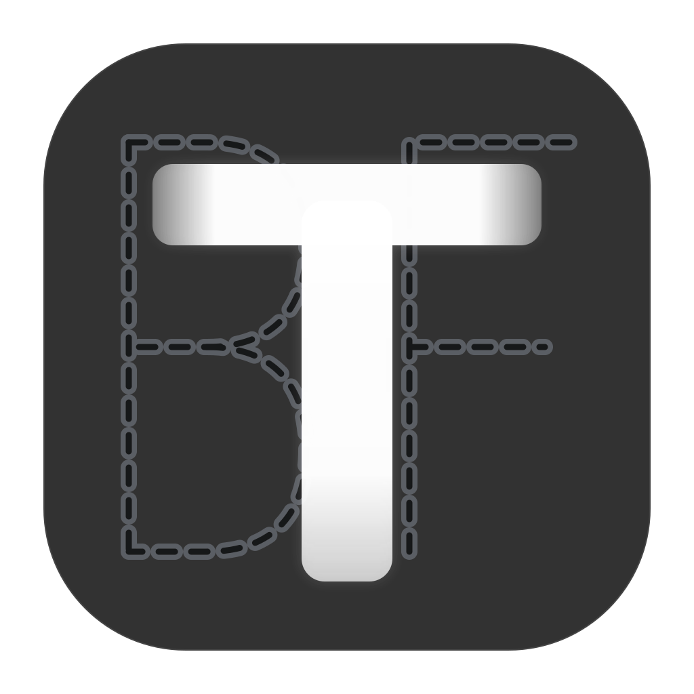
  <h1>CTF-BTFly</h1>
  <p><strong>基于 pi agent的Windows 智能体 CTF 解题工作台</strong></p>
  <p>将模型编排、终端、工具、证据与人工复核集中到一张本地工作台中。</p>
  <p>
    
    
    
    
    
  </p>
</div>


> [!CAUTION]
> CTF-BTFly 只能用于明确授权的 CTF 题目、靶场和安全研究环境。  
> 请勿使用本项目扫描、测试或攻击未授权目标，也不要把比赛附件、Flag、凭据或私有数据上传到第三方服务。

## 项目简介

CTF-BTFly 将桌面工作台与高权限控制平面分离：

- 🪟 **Wails + React 桌面端**负责题目管理、实时状态、事件时间线、终端转录、文件预览、Flag 审核、Writeup 和模型用量；
- ⚙️ **独立 Go daemon**负责 SQLite、Windows AppContainer、任务状态机、模型配置、资源配额和 Agent 生命周期；
- 🛡️ **每题一个 Windows 原生沙箱**，使用 AppContainer、Job Object、NTFS ACL 与受控 Named Pipe 隔离工作区、进程和资源；
- 🧠 **四种协作模式**覆盖标准模式、黑板模式、超级模式和多问题模式，按题目复杂度组织单模型或多模型协作；
- 🧰 **三层工具接入**包括只读 Tool Pack、任务与实例级绑定的 MCP Server，以及经明确配置的 Host Tool；
- 🚩 **Flag 主动上报与人工审核**允许 Agent 基于证据提交候选，确认后再进入 Writeup 阶段；
- 📊 **本地优先与可追溯**：任务状态、证据、用量和审计记录保存在本机 SQLite，敏感工作区不上传到第三方；
- 🎨 **15+ 套主题**覆盖深色、浅色、亮色与渐变配色，并支持字体、密度、背景和自定义强调色。

## 图文说明

**演示:** https://ctf-btfly-box.netlify.app

展示的是2.7.1版本已经不开源了，1.3.1开源，本项目代码2026/08已经删除了，可以去fork的找。

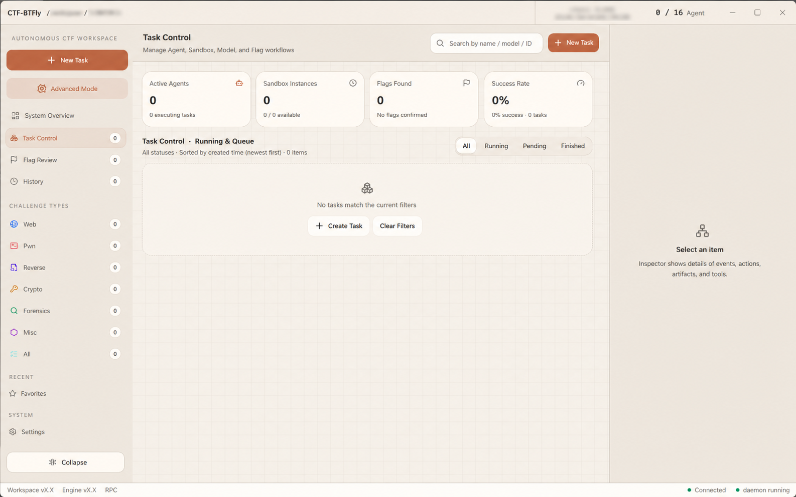

**系统概况集中显示本地控制平面、Windows 沙箱、资源状态和模型连接。**

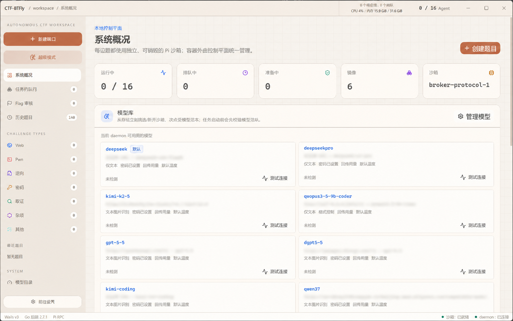

**新建题目时填写题目信息、授权目标和 Flag 格式，并选择模型、解题架构与 Tool Pack。**

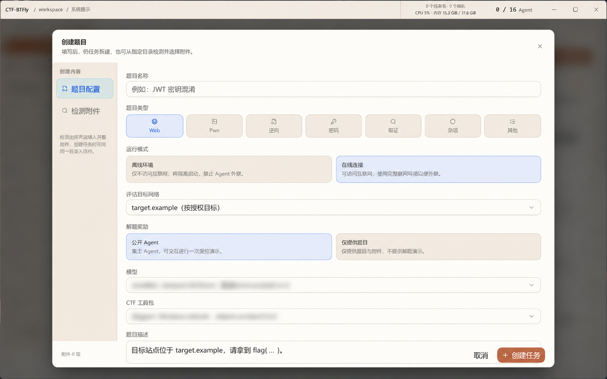

**进入超级模式前会检查当前任务和 Agent 状态，避免与已有运行任务争抢调度资源。**

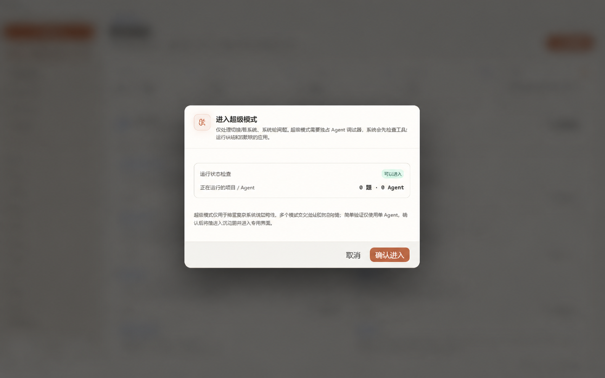

**超级模式由主 Agent 负责规划和调度，专家 Worker 按需启动，适合复杂、多附件和多路线题目。**

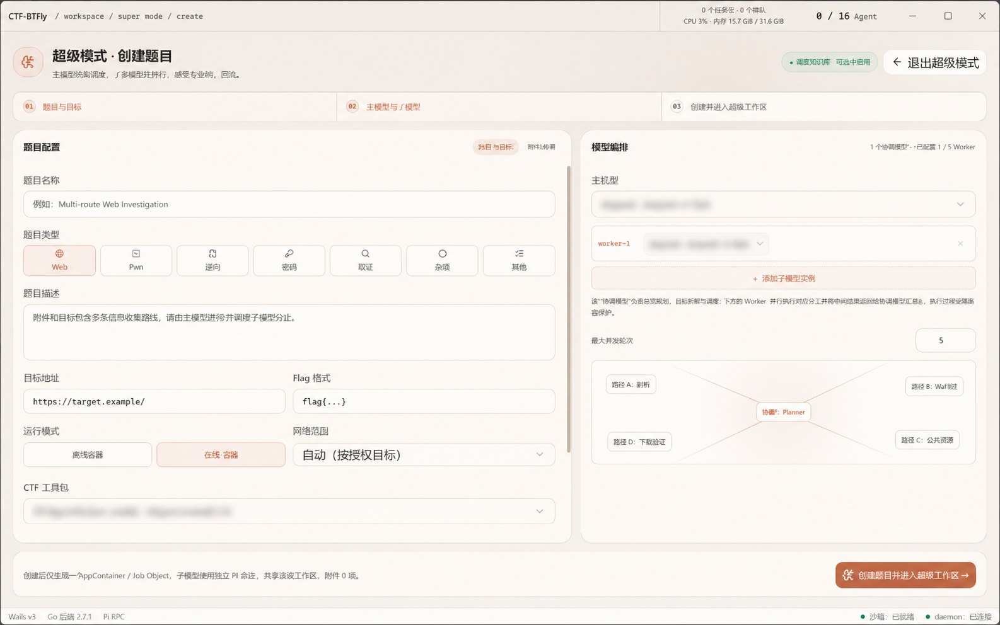

**Agent 发现高置信度 Flag 候选后会暂停扩展路线，等待操作员人工确认。**

**Tool Pack 以固定版本进入沙箱；本机 EXE、Python 和脚本可通过受控模板接入。**

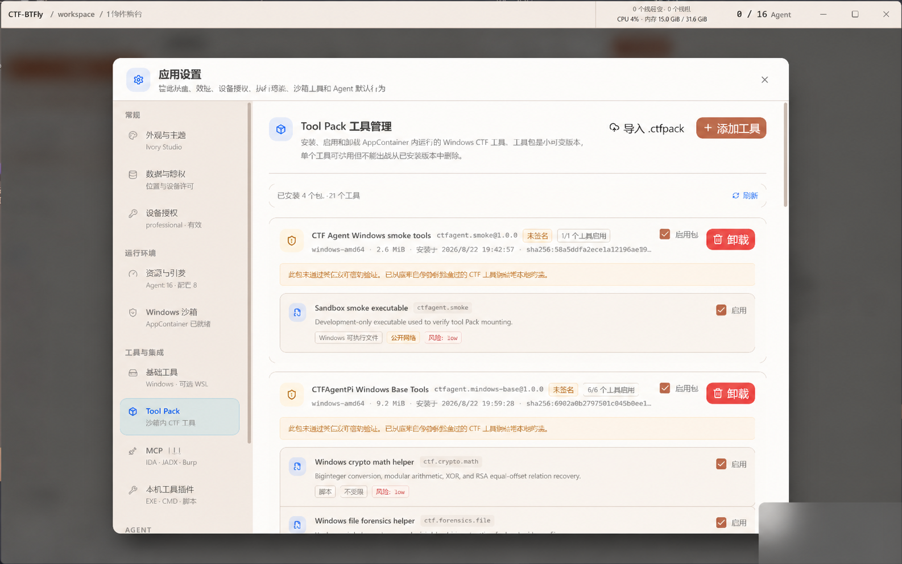

**MCP Server 可按题型、任务和具体服务器实例绑定，工具调用进入审计记录。**

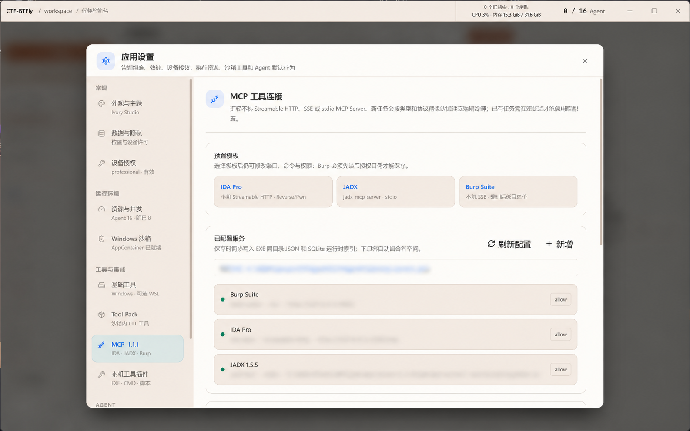

**模型用量按请求、题目和时间统计输入、输出、缓存与推理 Token。**

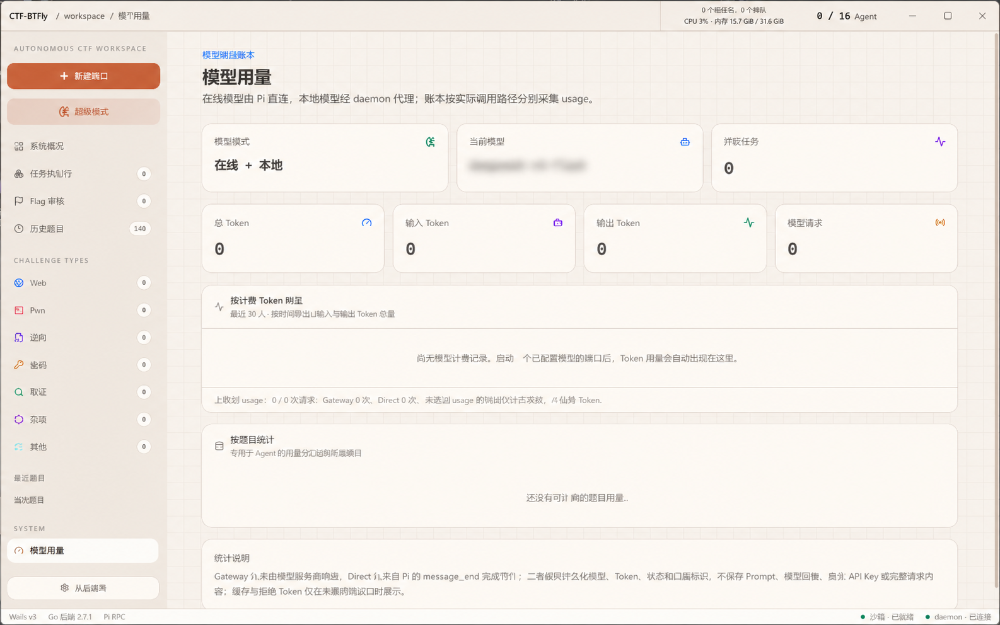

**外观设置支持界面密度、字体、背景、动态效果和自定义强调色。**

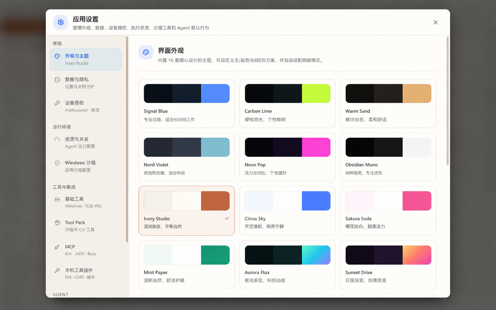

**历史题目保留必要的归档信息；公开截图中的题目名称、任务 ID、Flag 和本机 WP 路径均已打码。**

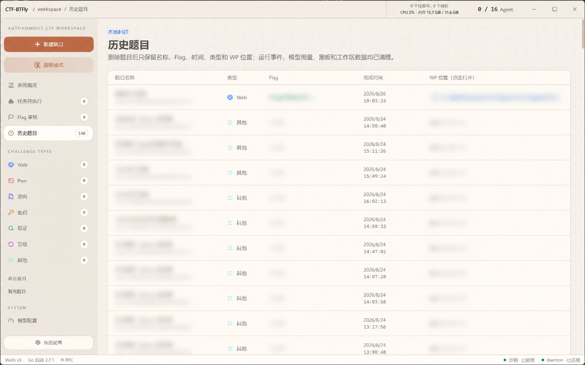

每道题的默认工作区结构：

```text
data/workspaces/task_xxx/
├── attachments/       用户上传的题目附件
├── artifacts/         Agent 保存的脚本、响应和证据
├── .pi-sessions/      Pi 会话数据
├── .cpi/              平台协议、候选结果与协作状态
└── WRITEUP.md         中文可复现解题报告
```

**感谢以下师傅对工具的认可，我会持续努力的更新！！！**

如有未统计上的师傅记得联系我🫡

**枫 二月犬 Skywalker ShyL0ck Archie_x hqn Douze 馬一强 御风 Albert L*o 听风 子鹿 魔天王 2rrr mycafday 秋雨渐冷. 爱弥斯**

------

如果你对工具或者agent感兴趣可以进群交流:921416626(群满＋二群)
## 致谢 
感谢以下开发者为本项目提交代码、修复Bug、完善文档、提供建议：
- [@dlongx](https://github.com/dlongx)：完善文档、提供建议

## 最后

**最后：🙏🏻🙏🏻🙏🏻**

**欢迎进群交流agent:921416626(群满＋二群)**